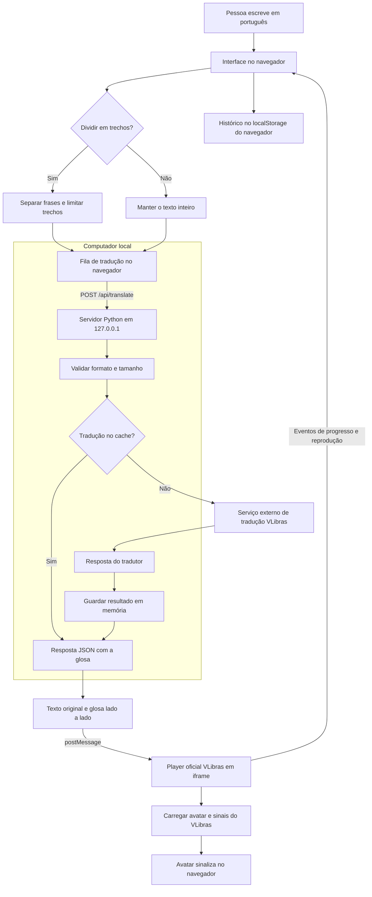

# Texto em Libras

Aplicativo local para escrever em português e acompanhar a tradução automática em um avatar 3D. O projeto organiza a entrada do texto, a revisão por trechos e os controles de reprodução. A tradução e a animação são fornecidas pelo VLibras.

## O que dá para fazer

- Traduzir textos de até 5.000 caracteres.
- Dividir textos longos em trechos menores, com prévia antes do envio.
- Conferir o texto de cada trecho junto da sequência de sinais retornada.
- Sinalizar um trecho individualmente ou reproduzir a sequência completa.
- Pausar, continuar, repetir, parar e ajustar a velocidade.
- Escolher entre os avatares Ícaro, Hosana e Guga.
- Cancelar uma tradução ou retomar os trechos pendentes após uma falha.
- Reutilizar as últimas oito frases pelo histórico do navegador.

É um protótipo para experimentar a integração com o VLibras. Não possui um motor próprio de tradução, não funciona offline e não adapta os movimentos para personagens personalizados.

## Requisitos

| Para usar | Requisito |
| --- | --- |
| Servidor local | Python 3.10 ou superior |
| Interface | Navegador atualizado com WebGL |
| Tradução, avatar e sinais | Acesso à internet |
| Testes de JavaScript | Node.js 20 ou superior |
| Testes de navegador, opcionais | Chrome e a dependência de desenvolvimento `playwright-core` |

Não é necessário instalar pacotes Python, configurar banco de dados ou fornecer uma chave de API. Node.js não é necessário para abrir e usar o aplicativo.

## Baixar e executar

```sh
 git clone https://github.com/Pexe171/Texto-em-Libras.git
 cd Texto-em-Libras
```

No Windows, abra **INICIAR LIBRAS.cmd** com dois cliques. O atalho inicia o servidor e abre o navegador.

Também é possível iniciar pelo terminal, a partir da pasta do projeto:

```sh
python aplicativo/servidor.py
```

No Linux ou macOS, use `python3` se esse for o nome do comando instalado.

O endereço padrão é **http://127.0.0.1:8765**. Mantenha o terminal aberto enquanto estiver usando a página. Para encerrar, pressione `Ctrl+C`.

Para escolher outra porta ou iniciar sem abrir o navegador:

```sh
python aplicativo/servidor.py --port 8766 --no-browser
```

## Como usar

1. Aguarde o avatar carregar e aparecer o estado **Pronto**.
2. Escreva ou cole o texto em português.
3. Para textos longos, mantenha **Traduzir em trechos menores** ativado e use **Ver trechos antes de traduzir** para conferir a divisão.
4. Clique em **Traduzir e sinalizar**, ou pressione `Ctrl+Enter`.
5. Abra a revisão para comparar cada trecho com a sequência retornada. Use **Sinalizar trecho** para conferir uma parte separadamente.

Se uma tradução parar no meio, **Retomar trechos pendentes** continua a partir dos trechos ainda não traduzidos. Os concluídos são preservados na página. Ao editar o texto ou preparar uma nova divisão, essa revisão é refeita.

O exemplo sobre mudanças na vida é uma versão editorial em frases mais diretas. Ele pode ser carregado, lido e editado antes da tradução. Não é uma tradução em Libras previamente validada.

## Blueprint: como funciona



### Do texto ao movimento

**1. Preparação do texto.** A interface aceita até 5.000 caracteres. Com a divisão ativada, `text-utils.js` separa frases por pontuação ou quebra de linha. Trechos maiores são divididos preferencialmente nas vírgulas e, quando necessário, entre palavras, buscando um limite de 220 caracteres. O código não substitui palavras nem corrige o sentido do texto.

**2. Tradução em fila.** `app.js` envia um trecho por vez ao servidor local. A página mostra o progresso e permite interromper a fila. Se houver uma falha, os trechos concluídos continuam disponíveis para revisão e reprodução individual; a sequência completa só é enviada ao avatar quando todos terminam.

**3. Comunicação com o VLibras.** `servidor.py` valida o pedido e consulta o serviço de tradução. O resultado é uma **glosa**: uma representação textual da sequência que será interpretada pelo player. Ela não precisa ter a mesma ordem ou a mesma forma de uma frase em português.

**4. Reprodução.** O navegador envia a glosa ao player oficial por `postMessage`. O player carrega os recursos dos servidores VLibras e controla a animação. Os controles de pausa, velocidade, avatar e repetição usam esse mesmo canal. As mensagens recebidas pela página são verificadas pela origem e pela janela do iframe.

### O que roda onde

| Componente | Responsabilidade |
| --- | --- |
| Interface local | Texto, divisão, fila, revisão, histórico e controles |
| Servidor Python local | Validação, chamada ao tradutor, tentativas e cache |
| Serviço de tradução VLibras | Converter o português para a sequência de sinais |
| Player e acervo VLibras | Carregar os recursos e animar o avatar |

O servidor atende somente em `127.0.0.1`; ele não publica o aplicativo na rede. A pasta servida é `aplicativo/public`, não a raiz do projeto.

### API local

| Método | Endereço | Resultado |
| --- | --- | --- |
| `GET` | `/` | Interface do aplicativo |
| `GET` | `/api/health` | Estado do servidor local; não testa os serviços externos |
| `POST` | `/api/translate` | Tradução de um texto em uma glosa |

Exemplo de requisição:

```http
POST /api/translate
Content-Type: application/json

{"text":"Olá, tudo bem?"}
```

Exemplo de resposta:

```json
{"gloss":"OI TUDO_BEM [INTERROGAÇÃO]"}
```

O conteúdo traduzido depende da resposta do VLibras e pode mudar. Pedidos inválidos recebem `400`; origem externa informada no pedido é rejeitada com `403`; formato diferente de JSON recebe `415`. Falhas do serviço de tradução são apresentadas ao navegador como `502`, acompanhadas de uma mensagem sobre a causa.

### Tentativas, cache e armazenamento

O servidor faz até três tentativas para erros temporários, como falhas de conexão, respostas HTTP 408, 429 e 5xx. Cada tentativa de conexão usa um timeout de oito segundos. Entre tentativas, há uma pequena espera. A interface limita a espera de cada trecho a 35 segundos.

Até 128 traduções bem-sucedidas ficam em um cache em memória. Erros não entram no cache. Ele é compartilhado pelas requisições daquele processo e desaparece quando o servidor é encerrado.

O histórico guarda até oito textos no `localStorage` do navegador. Pode ser apagado pela própria interface. O servidor não salva as frases em arquivos, mas os textos são enviados ao serviço externo para tradução. O navegador também carrega o player, os sinais e fontes externas.

Cancelar interrompe a fila no navegador. Uma requisição já recebida pelo servidor pode terminar em segundo plano.

## Estrutura do repositório

```text
Texto-em-Libras/
├── .gitignore
├── INICIAR LIBRAS.cmd
├── README.md
└── aplicativo/
    ├── servidor.py
    ├── public/
    │   ├── index.html
    │   ├── style.css
    │   ├── app.js
    │   ├── text-utils.js
    │   └── texto-vida.txt
    └── qa/
        ├── package.json
        ├── package-lock.json
        ├── test_servidor.py
        ├── test-text.cjs
        ├── verificar.cjs
        └── verificar-texto-longo.cjs
```

Modelos Blender, downloads de pesquisa, cópias do código do VLibras, caches e `node_modules` não fazem parte da distribuição. Eles não são necessários para executar esta versão.

## Testes

### Verificações locais

Na raiz do projeto:

```sh
python aplicativo/qa/test_servidor.py
node aplicativo/qa/test-text.cjs
node --check aplicativo/public/app.js
```

Os testes Python verificam tentativas após falha, cache, rejeição de respostas inválidas e tratamento de erros do tradutor. Os testes de divisão conferem a preservação de palavras e pontuação, o tratamento de números e os limites dos trechos. Essas verificações não precisam acessar o VLibras.

### Verificações no navegador

Instale a dependência de teste:

```sh
npm ci --prefix aplicativo/qa
```

O Chrome deve estar instalado. Por padrão, os scripts procuram o executável em `C:/Program Files/Google/Chrome/Application/chrome.exe`. Para outro caminho, defina `BROWSER_PATH`. Exemplo no PowerShell:

```powershell
$env:BROWSER_PATH = 'C:\caminho\para\chrome.exe'
```

Com o servidor na porta **8765**, execute:

```sh
node aplicativo/qa/verificar.cjs
```

Esse teste consulta o tradutor real, carrega o avatar e verifica a integração, os controles, o histórico e o layout de celular. Ele pode falhar se o VLibras estiver indisponível.

Para o teste de textos longos, inicie outro servidor na porta **8766**:

```sh
python aplicativo/servidor.py --port 8766 --no-browser
```

Em outro terminal:

```sh
node aplicativo/qa/verificar-texto-longo.cjs
```

Esse teste usa respostas de tradução simuladas para verificar a fila, a falha parcial, a retomada e o cancelamento. O avatar continua sendo carregado do serviço real. Não é um teste de qualidade linguística. Capturas e relatórios gerados são ignorados pelo Git.

## Problemas comuns

| Situação | O que fazer |
| --- | --- |
| `python` não é reconhecido | Instale Python 3.10+ e confira se o comando está disponível no terminal. |
| A porta 8765 está ocupada | Encerre a instância anterior ou use `--port 8766`. |
| O avatar demora ou não carrega | Confira a conexão, o suporte a WebGL e tente carregar novamente pela página. |
| O terminal mostra `POST /api/translate ... 502` | Veja a mensagem da interface. O serviço externo pode ter retornado erro, excedido o tempo de resposta ou ficado inacessível. Use a retomada se houver trechos concluídos. |
| A glosa omite palavras ou escolhe um sentido errado | Revise o trecho em português, experimente uma frase mais direta e confira o resultado com alguém fluente em Libras. Repetir a mesma chamada não garante uma correção. |
| Uma atualização não aparece | Reinicie o servidor após mudanças no Python e use `Ctrl+F5` no navegador para atualizar a interface. |

## Limitações

A integração técnica não garante uma tradução linguisticamente correta. Nos testes, o serviço externo apresentou omissões e escolhas inadequadas de sentido, principalmente em textos abstratos. Dividir o texto pode facilitar a revisão, mas também pode retirar contexto. O modo de divisão pode ser desativado para comparar os resultados.

O projeto não inclui uma revisão linguística automática, um acervo próprio de animações ou um mecanismo para treinar avatares. Também não substitui um intérprete de Libras. Mudanças nos serviços ou no protocolo do player podem exigir ajustes no código.

## Referências e créditos

A tradução, os avatares e o acervo de sinais pertencem ao ecossistema VLibras. Este aplicativo é uma integração independente com os serviços disponibilizados pelo projeto.

- [Portal oficial VLibras](https://www.gov.br/governodigital/pt-br/acessibilidade-e-usuario/vlibras/vlibras)
- [Documentação de integração](https://vlibras.gov.br/doc/widget/installation/webpageintegration.html)
- [Repositório oficial VLibras Web](https://github.com/spbgovbr-vlibras/vlibras-web-browsers)
- [Endereços dos serviços usados pelo VLibras](https://github.com/spbgovbr-vlibras/vlibras-web-browsers/blob/dev/src/core/config/index.ts)
- [Protocolo de comunicação do player](https://github.com/spbgovbr-vlibras/vlibras-web-browsers/blob/dev/src/player/unity/index.js)

Os componentes externos seguem suas próprias licenças e condições de uso. O repositório não redistribui o player nem os modelos 3D do VLibras.
